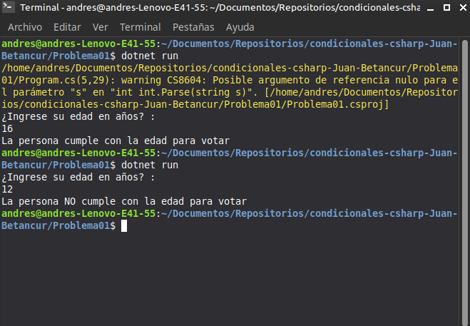

# Problema 01. Registro electoral

**Estructura elegida:** Estructura condicional `if-else`

**Justificación:** Se requiere evaluar una condición booleana directa (si la edad es mayor o igual a 16) para bifurcar el flujo del programa en dos caminos posibles (cumple o no cumple).

**Evidencia:**
