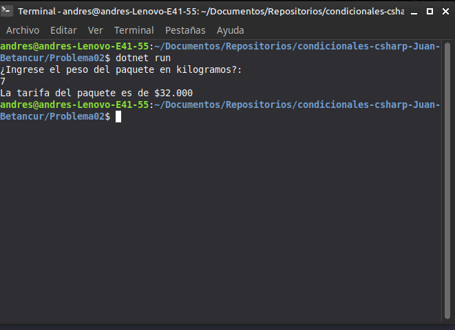

# Problema 02. Tarifa de envío por peso

**Estructura elegida:** `if-else` combinada con `switch expression`

**Justificación:** Se utiliza un `if` inicial para validar los casos de error o pesos no válidos (menores o iguales a cero), y una expresión `switch` moderna con rangos (`and`, `<`) para asignar de forma limpia la tarifa numérica correspondiente según los tramos de peso.

**Evidencia:**
