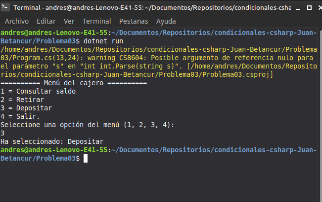

# Problema 03. Menú de cajero automático

**Estructura elegida:** Instrucción `switch` tradicional

**Justificación:** Es la estructura ideal para evaluar opciones discretas y exactas (números enteros del 1 al 4), permitiendo asociar cada caso de forma limpia y utilizando un bloque `default` para manejar las opciones no válidas.

**Evidencia:**
