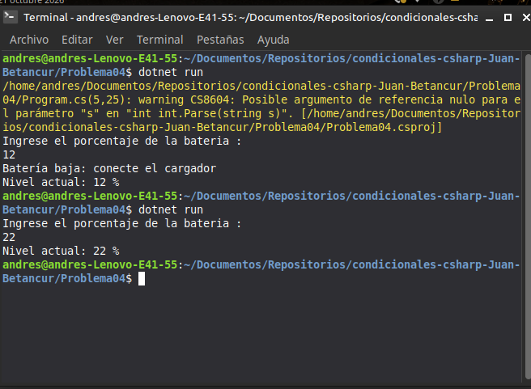

# Problema 04. Alerta de batería

**Estructura elegida:** Estructura condicional simple (`if`)

**Justificación:** Permite evaluar de forma independiente si se cumple una condición puntual (nivel de batería menor al 15 %) para mostrar un mensaje de advertencia opcional, asegurando al mismo tiempo que el flujo del programa continúe de forma secuencial para imprimir siempre el nivel actual de la batería al finalizar.

**Evidencia:**
