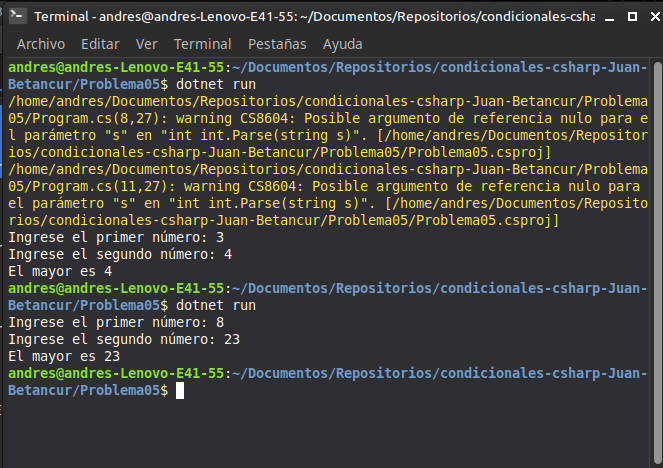

# Problema 05. El mayor de dos números

**Estructura elegida:** Operador condicional ternario (`? :`)

**Justificación:** Permite evaluar la condición y asignar el valor mayor en una sola línea de código de forma clara y directa.

**Evidencia:**
