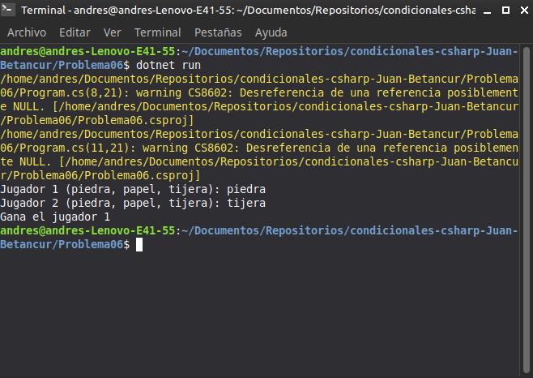

# Problema 06. Piedra, papel o tijera

**Estructura elegida:** Estructuras condicionales anidadas (`if-else if-else`)

**Justificación:** Se requiere evaluar múltiples combinaciones posibles entre las elecciones de ambos jugadores para determinar el ganador o empate.

**Evidencia:**
