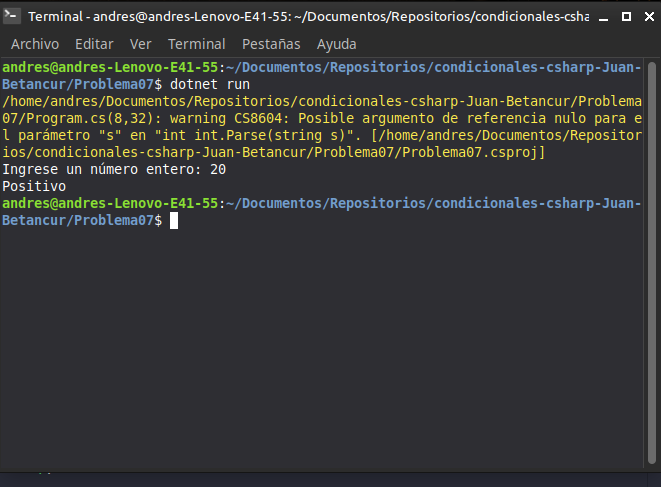

# Problema 07. Signo de un número

**Estructura elegida:** Condicional múltiple (`if-else if-else`)

**Justificación:** Evalúa de forma secuencial tres posibles estados excluyentes: si es mayor, menor o igual a cero.

**Evidencia:**
