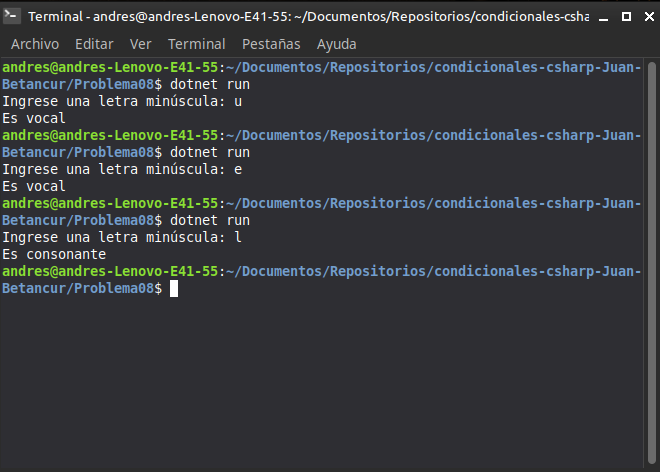

# Problema 08. Vocal o consonante

**Estructura elegida:** `switch` con expresiones múltiples

**Justificación:** Agrupa eficientemente las vocales en un solo caso y valida caracteres alfabéticos frente a otros símbolos.

**Evidencia:**
