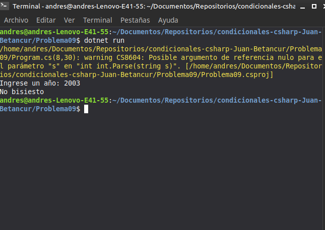

# Problema 09. Año bisiesto

**Estructura elegida:** Condicional compuesto con operadores lógicos (`if` con `&&` y `||`)

**Justificación:** Permite evaluar la regla matemática completa de los años bisiestos en una sola condición lógica.

**Evidencia:**
