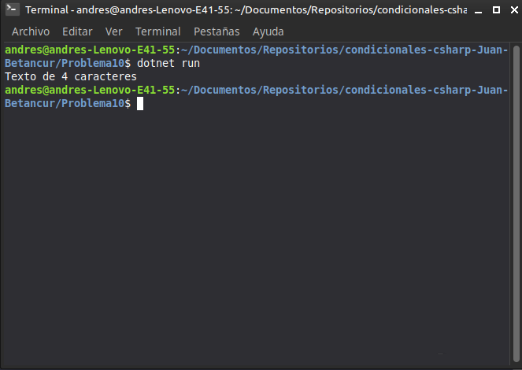

# Problema 10. Analizador de datos recibidos

**Estructura elegida:** Patrones de coincidencia con `switch` (`switch expression` / `is`)

**Justificación:** Facilita la identificación limpia y moderna del tipo de dato contenido en una variable de tipo `object`.

**Evidencia:**
