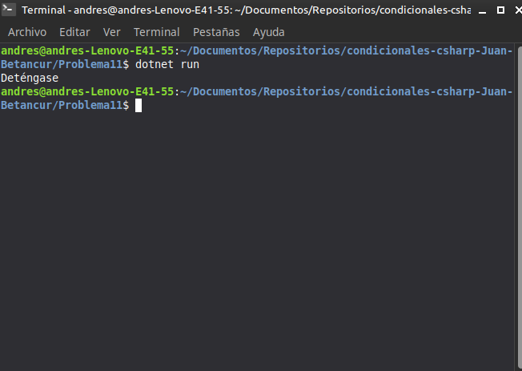

# Problema 11. Semáforo inteligente

**Estructura elegida:** Enumeración con `switch`

**Justificación:** El uso de un `enum` garantiza la restricción de estados válidos, y el `switch` resuelve claramente cada instrucción asociada.

**Evidencia:**
