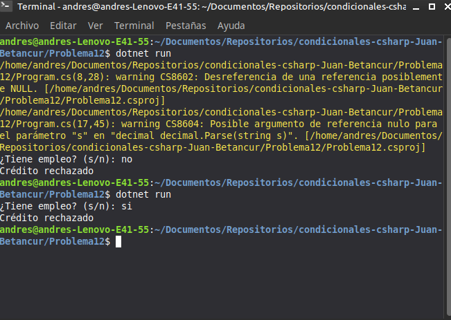

# Problema 12. Aprobación de crédito

**Estructura elegida:** Condicionales anidados (`if-else` dentro de `if-else`)

**Justificación:** Permite validar primero una condición previa obligatoria (tener empleo) antes de evaluar los rangos de ingresos.

**Evidencia:**
