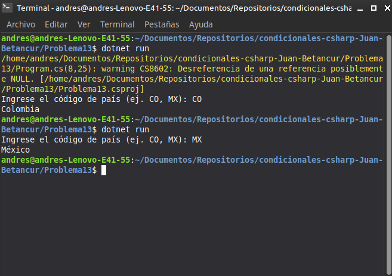

# Problema 13. Códigos de país

**Estructura elegida:** Estructura `switch`

**Justificación:** Es la opción óptima para evaluar la coincidencia exacta de una cadena de texto contra múltiples opciones discretas.

**Evidencia:**
