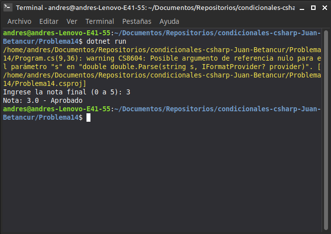

# Problema 14. Estado del aprendiz

**Estructura elegida:** Operador condicional ternario (`? :`)

**Justificación:** Permite evaluar la nota y asignar el texto correspondiente ("Aprobado" o "Reprobado") en una sola línea de asignación.

**Evidencia:**
