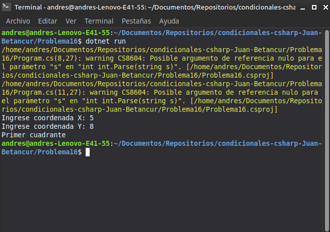

# Problema 16. Ubicación de un dron

**Estructura elegida:** Condicionales múltiples con operadores lógicos

**Justificación:** Permite discriminar con precisión si el punto se encuentra en el origen, sobre los ejes cartesianos o en qué cuadrante específico reside.

**Evidencia:**
