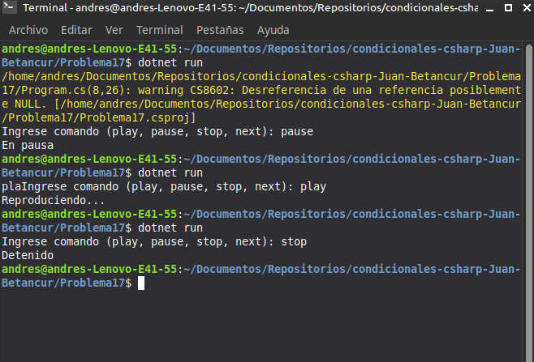

# Problema 17. Control de un reproductor

**Estructura elegida:** Instrucción `switch`

**Justificación:** Ideal para manejar comandos de texto discretos y estandarizados hacia acciones concretas.

**Evidencia:**
