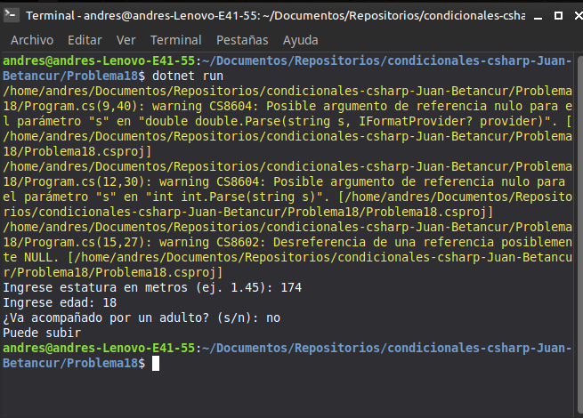

# Problema 18. Montaña rusa

**Estructura elegida:** Condicional compuesto con combinación de operadores lógicos (`&&`, `||`)

**Justificación:** Agrupa las reglas de negocio complejas sobre estatura, edad y condición de acompañante de forma clara.

**Evidencia:**
