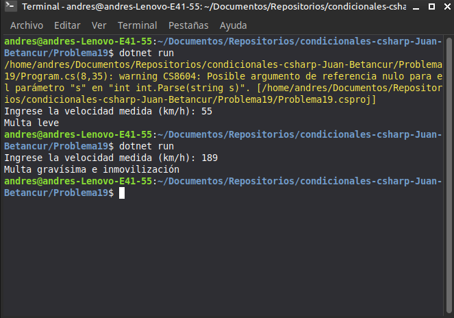

# Problema 19. Radar de velocidad

**Estructura elegida:** Escalera `if-else if`

**Justificación:** Evalúa rangos de velocidad ascendentes para asignar correctamente la sanción correspondiente.

**Evidencia:**
