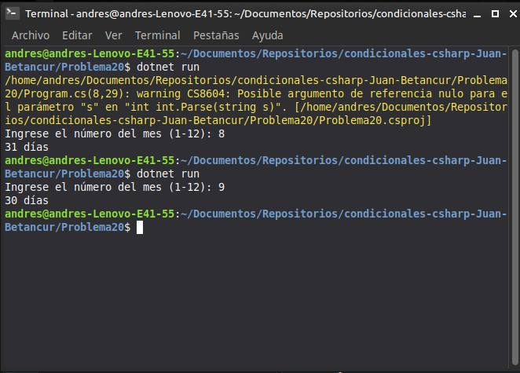

# Problema 20. Dendencias / Switch múltiple

**Estructura elegida:** Expresión `switch` con múltiples patrones combinados

**Justificación:** Permite agrupar eficientemente los meses que comparten la misma cantidad de días en una sola sentencia.

**Evidencia:**
