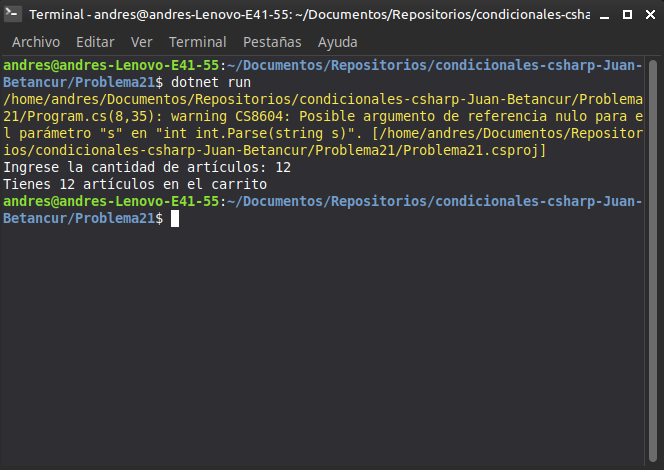

# Problema 21. Carrito de compras

**Estructura elegida:** Operador condicional ternario (`? :`) en interpolación de cadenas

**Justificación:** Permite alternar dinámicamente entre singular y plural dentro de una sola línea de asignación de texto.

**Evidencia:**
