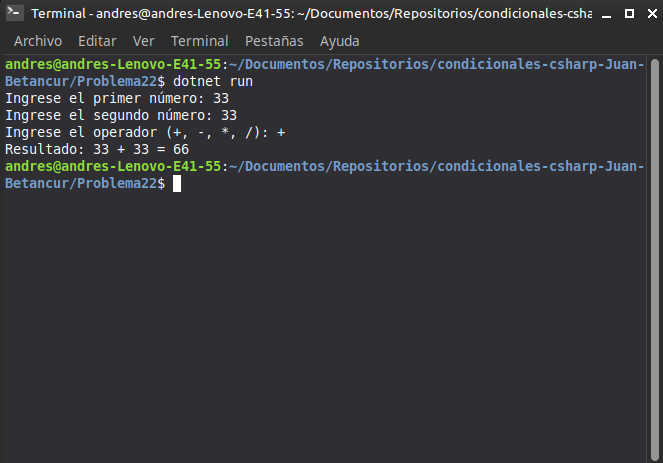

# Problema 22. Calculadora básica

**Estructura elegida:** Estructura `switch` con lanzamiento de excepciones

**Justificación:** Maneja adecuadamente las operaciones aritméticas y lanza excepciones controladas ante errores de división por cero u operadores desconocidos.

**Evidencia:**
