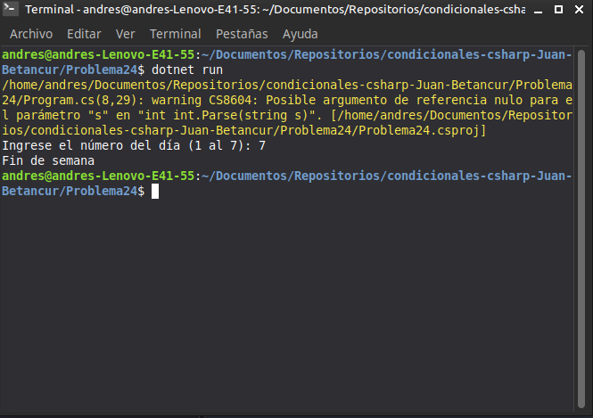

# Problema 24. ¿Día hábil?

**Estructura elegida:** Expresión `switch`

**Justificación:** Clasifica eficientemente los días numéricos en categorías de días hábiles, fines de semana o valores no válidos.

**Evidencia:**
