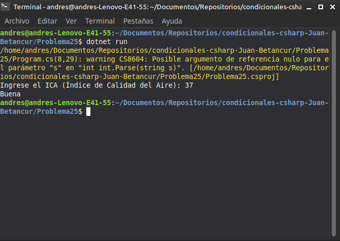

# Problema 25. Calidad del aire

**Estructura elegida:** Escalera `if-else if`

**Justificación:** Es idóneo para validar rangos numéricos continuos correspondientes al Índice de Calidad del Aire (ICA).

**Evidencia:**
