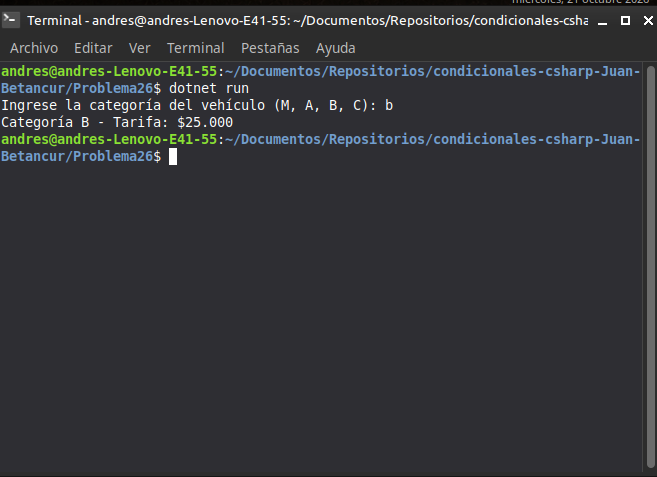

# Problema 26. Peaje

**Estructura elegida:** Expresión `switch` con excepción integrada

**Justificación:** Mapea las categorías vehiculares a sus tarifas e implementa una excepción predeterminada para letras no reconocidas.

**Evidencia:**
