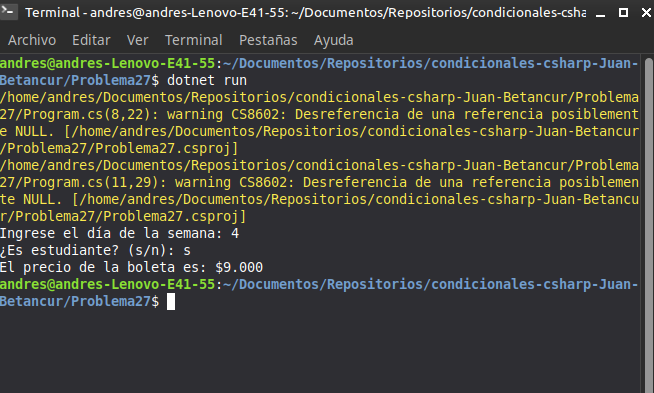

# Problema 28. Descuento por compra

**Estructura elegida:** Escalera `if-else if` combinada con lógica booleana

**Justificación:** Permite calcular de forma ordenada los descuentos base por valor de compra y sumar bonificaciones adicionales según membresía.

**Evidencia:**
