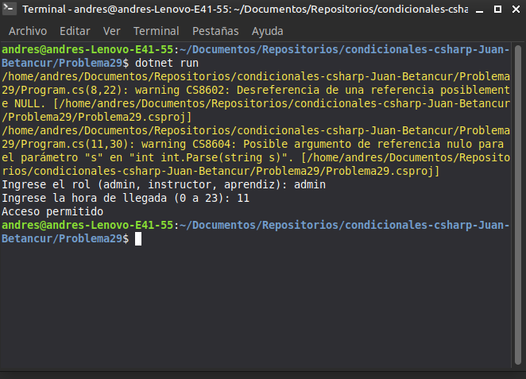

# Problema 29. Control de acceso a la sede

**Estructura elegida:** Estructura `switch` con guardas condicionales (`when`)

**Justificación:** Las guardas `when` en C# permiten evaluar restricciones horarias específicas directamente en cada rol.

**Evidencia:**
