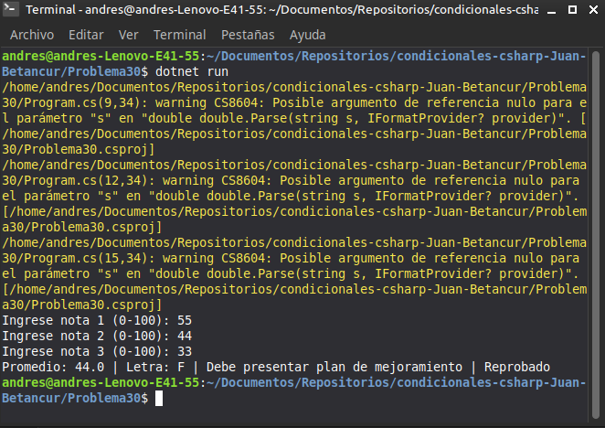

# Problema 30. Boletín de calificaciones (integrador)

**Estructura elegida:** Estructuras combinadas (`if-else if` y expresiones `switch`)

**Justificación:** Permite integrar cálculos aritméticos, conversión de rangos a letras, mensajes de retroalimentación y validación de menciones de honor en un solo flujo completo.

**Evidencia:**
